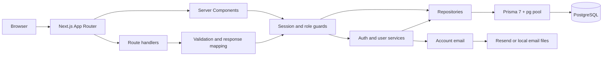

# Architecture

PitchMate uses a modular monolith in a single Next.js App Router deployment. PostgreSQL is the system of record. Client components handle the interactions that need browser state, including forms, navigation dialogs, theme selection and authentication actions. Landing and dashboard content uses Server Components.



Route handlers parse HTTP inputs and translate service results. Domain services coordinate account workflows. Repositories own database queries and transactions. Dashboard guards bind access to the current server-side account role, and the self-service profile API derives the target account ID from the session.

Prisma uses the generated TypeScript client in `src/generated/prisma`. Generation is part of the development, build, typecheck and Vitest commands. The process-level Prisma client reuses a PostgreSQL connection pool. JWTs carry an account ID and revocation version, while PostgreSQL supplies current role and status on authenticated requests.

Account email is scheduled after the HTTP response. Verification resend and password recovery let users retry. A durable outbox is a future delivery improvement.

## Folder structure

```text
pitchmate/
├── docs/
├── prisma/
│   ├── migrations/
│   ├── schema.prisma
│   ├── seed.ts
│   ├── admin.ts
│   └── provision-admin.ts
├── public/
│   ├── images/
│   └── logo/
├── src/
│   ├── app/
│   │   ├── (public)/
│   │   ├── (auth)/
│   │   │   ├── login/
│   │   │   ├── register/
│   │   │   ├── register-owner/
│   │   │   ├── forgot-password/
│   │   │   ├── reset-password/
│   │   │   ├── verify-email/
│   │   │   └── resend-verification/
│   │   ├── (customer)/dashboard/
│   │   ├── owner/dashboard/
│   │   ├── admin/dashboard/
│   │   ├── account/
│   │   ├── api/{auth,health,users}/
│   │   ├── fonts/
│   │   └── layout.tsx, globals.css, error.tsx, not-found.tsx
│   ├── components/{branding,forms,layouts,shared,ui}/
│   ├── config/
│   ├── constants/
│   ├── generated/prisma/
│   ├── hooks/
│   ├── lib/
│   ├── modules/{auth,users,venues,bookings,pricing,payments}/
│   ├── types/
│   └── instrumentation.ts
├── tests/{unit,integration,e2e}/
├── .env.example
├── bun.lock
├── components.json
├── docker-compose.yml
├── package.json
└── prisma.config.ts
```

`venues`, `bookings`, `pricing` and `payments` are reserved for future domain modules. The customer, owner and admin dashboards share layout primitives and define separate navigation and server-side access rules.
