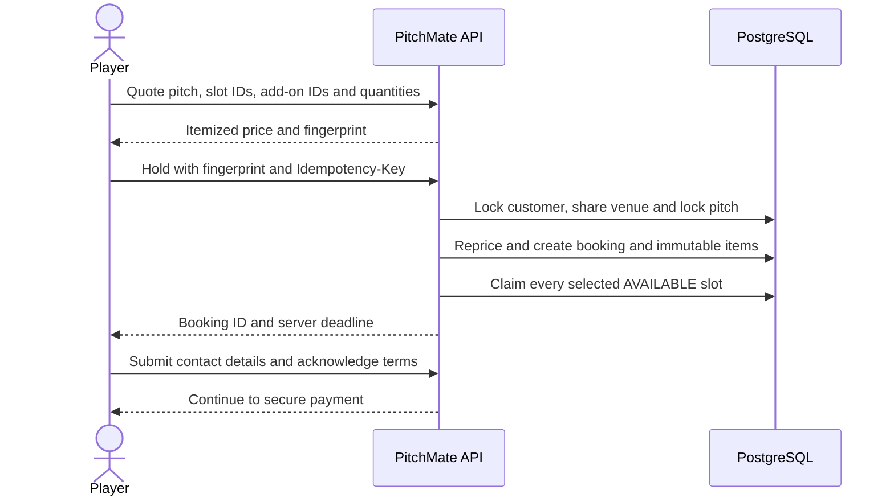

# Booking engine

PitchMate reserves a specific pitch and one or more consecutive slots. The customer selects available times, reviews the server quote, creates a hold, and completes provider checkout. A hold can last up to the configured duration or until the first slot begins. The default is ten minutes.

The quote is advisory. Hold creation checks publication, pitch activity, slot ownership and status, the venue-local horizon, contiguity, and the pitch's duration limits. Generated inventory reflects the operating schedule. Schedule and booking writers share the same venue and pitch locks. If the fingerprint changes before the hold, the customer reviews a refreshed quote and submits again.

The checkout page reads the authoritative booking and lets customers save contact details before refreshing or paying. Updating contact details cannot change the reserved slots, add-ons, deadlines, or amounts. To change the selection, release the unpaid hold and create a new one. The server deadline controls both acquisition and payment confirmation.

The customer can see upcoming, completed, pending, expired and released bookings. Confirmation enables a private PDF receipt and an ICS calendar download. The receipt is a booking receipt. Applicable taxes are represented as configured line items.

Phase 4 manual bookings call the shared quote, snapshot and slot-claim functions. Operational writes lock inventory before changing booking state, or use a dedicated payment and refund transaction against the locked booking. A replacement transfers shared inventory and releases original-only inventory atomically. [Manual bookings](MANUAL_BOOKINGS.md) · [Rescheduling](RESCHEDULING.md)
