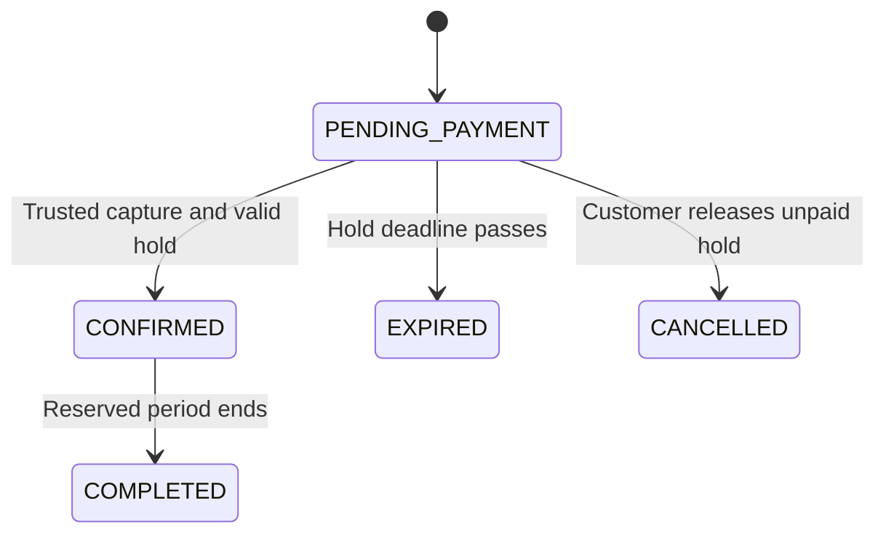
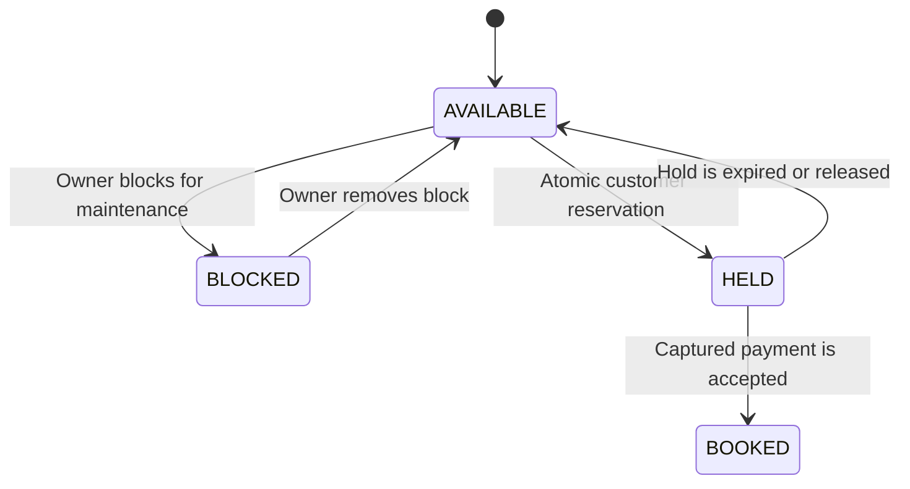
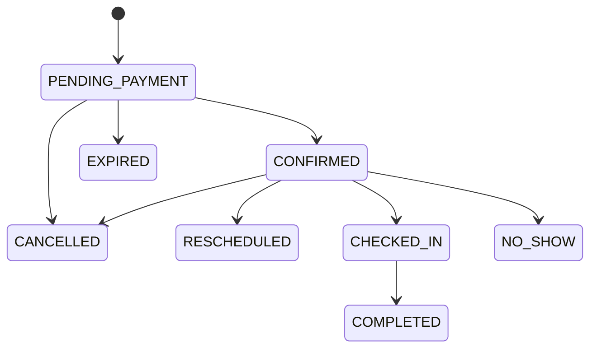

# Booking and slot states

Payment attempts have separate states. A payment may be captured even if its booking is expired or another capture already confirmed the booking. Such a capture remains recorded and enters compensation. An expired booking stays expired. Duplicate observations of an accepted capture return the existing state.

## Operations

An offline reservation moves through pending and confirmed inside its inventory transaction, possibly with a remaining balance. Customer cancellation is available before start. Check-in is allowed from the configured early window through the booking end. Completion requires attendance, and no-show requires the booking to end. The scheduled worker can complete elapsed checked-in sessions. Payment status remains independent from attendance.
