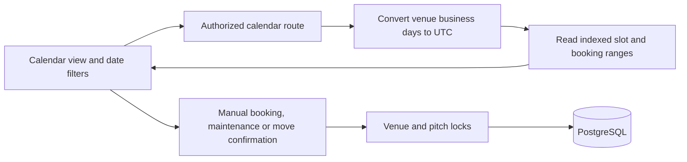

# Operational calendar

The calendar loads the visible date interval in the selected venue’s time zone. The server scopes reads by current owner approval or active staff membership and uses booking and slot date indexes. A calendar request is limited to 31 days. The list and pitch views expose the same status labels as the day and week grids. The browser refreshes every 20 seconds and on demand.



Click an available slot to quote a manual booking or block the interval for maintenance. Click an event to open the reservation details. Drag a confirmed booking over an available slot, or choose Reschedule and select a destination with the keyboard. The client confirms a new quote before making a write. PostgreSQL remains authoritative until the server accepts the operation.

Calendar maintenance records a reason on the existing slot. Schedule regeneration preserves blocked inventory. An operator can reopen a future calendar block. The pitch’s current schedule still determines whether the interval is sellable after it reopens.

Calendar request example:

```text
GET /api/owner/calendar?venueId=<uuid>&from=2026-11-24&to=2026-11-30
```
