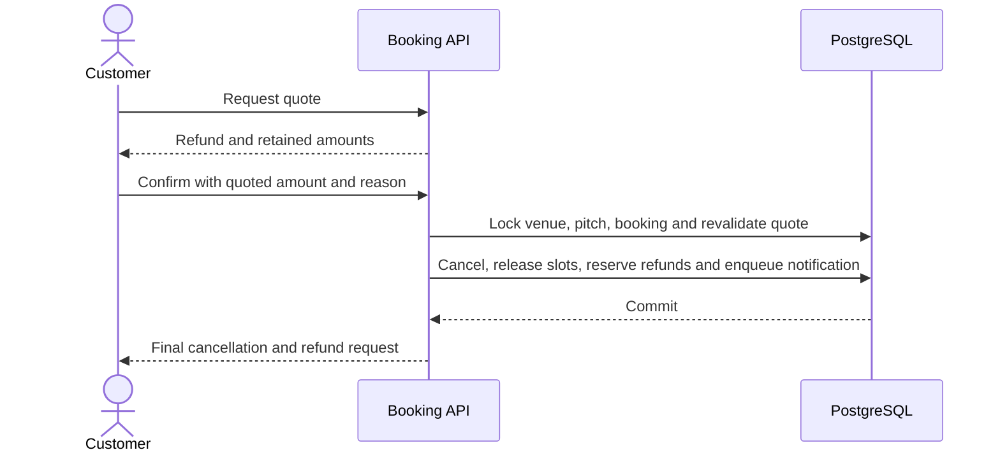

# Cancellation policy

A venue may activate one policy version at a time. Editing creates a new version. Each new reservation snapshots the active policy and descriptive rules. Older Phase 3 records and venues without an active version use the documented standard rules of 100% at 24 hours, 50% at 12 hours, and 0% closer to the session.

A rule applies from its threshold through the next higher threshold. Customer cancellation closes at the start time. The eligible percentage applies to the captured, applied charge, including fees and tax. The quote is capped by captured money remaining after existing refund commitments. Owner, admin, weather, maintenance, and emergency cancellations qualify for the remaining applied balance.

Once the booking is cancelled, a retry returns the existing cancellation record. A quote change returns a conflict with the revised amount available through the quote endpoint.
