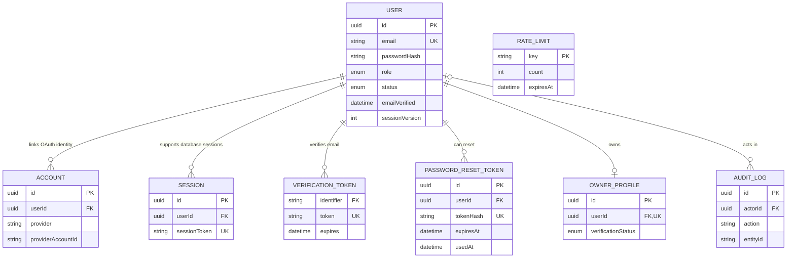
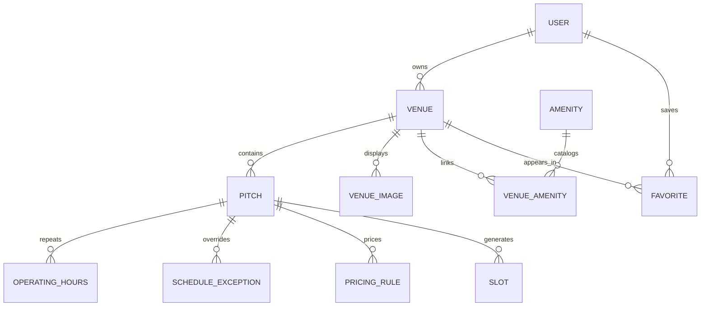
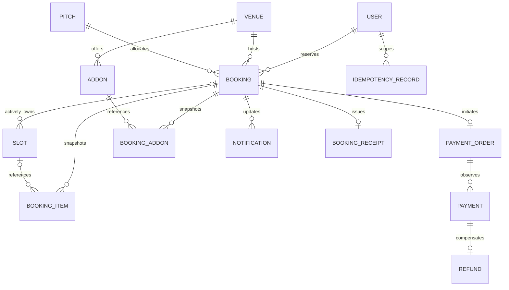
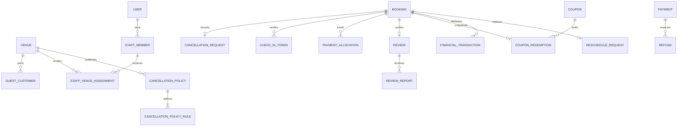

# Database

PostgreSQL 17 runs through Compose for local development. Prisma 7 uses `prisma-client` generation and `@prisma/adapter-pg`. The initial migration creates all Phase 1 tables, foreign keys, enums and indexes. Application dates use `timestamptz(3)`. The database pool sets its timezone to UTC.

| Model                | Integrity and lifecycle                                                                                                                               |
| -------------------- | ----------------------------------------------------------------------------------------------------------------------------------------------------- |
| `User`               | UUID ID, normalized unique email, nullable Argon2id hash, role and status indexes, profile fields, revocation counter and timestamps.                 |
| `Account`            | Unique provider/subject pair. Stores Google identity linkage. OAuth access and refresh tokens are unused by PitchMate.                                |
| `Session`            | Auth.js-compatible table for a future database-session strategy. Phase 1 uses JWT sessions.                                                           |
| `VerificationToken`  | SHA-256 digest, expiry and an email foreign key. Consuming a link removes outstanding verification links.                                             |
| `PasswordResetToken` | SHA-256 digest, UUID, expiry and consumption timestamps. A password change invalidates outstanding reset links.                                       |
| `OwnerProfile`       | Unique user foreign key, business name and phone, timestamps and indexed verification status. Creation is part of the owner registration transaction. |
| `AuditLog`           | Records actor, action, resource, optional metadata and timestamp. Actor deletion clears the foreign key while preserving the audit record.            |
| `RateLimit`          | HMAC-keyed scope and subject, attempt count and expiry. Atomic upserts serialize concurrent updates to the same bucket.                               |

Dependent account, session, verification and recovery records cascade on user deletion. User roles are `CUSTOMER`, `OWNER` and `ADMIN`. User statuses are `ACTIVE`, `SUSPENDED` and `INACTIVE`. Owner statuses are `PENDING`, `APPROVED` and `REJECTED`.

Use `bun run db:migrate` locally and `bun run db:deploy` with the migration database credentials during deployment. Keep a separate runtime role with only the table privileges the app requires. Generate Prisma Client with `bun run db:generate`. Use [the schema](../prisma/schema.prisma) as the source of field-level detail.

## Phase 2 schema

| Model                                | Data and constraints                                                                                                                                                                                                               |
| ------------------------------------ | ---------------------------------------------------------------------------------------------------------------------------------------------------------------------------------------------------------------------------------- |
| Venue                                | Owner, unique stable slug, contact and location, timezone, moderation and publication timestamps. Database checks require paired coordinates and allow a publication timestamp only on an active approved record.                  |
| Pitch                                | One independently managed ground, integer paise base rate, type, surface, dimensions, capacity and aligned booking-duration limits.                                                                                                |
| VenueImage                           | Unique storage key, public URL and alt text. A partial unique index ensures at most one cover per venue.                                                                                                                           |
| MediaCleanup                         | Durable cleanup queue for interrupted uploads and pending deletes.                                                                                                                                                                 |
| Amenity and VenueAmenity             | Seeded catalog and composite-key venue membership.                                                                                                                                                                                 |
| OperatingHours and ScheduleException | Local-minute intervals for recurring weekdays and per-pitch date overrides. Calendar dates use PostgreSQL `DATE`.                                                                                                                  |
| PricingRule                          | Local weekday and clock bands, inclusive effective dates, paise hourly rates and explicit priority. Equal-priority overlaps are rejected under the pitch lock.                                                                     |
| Slot                                 | UTC `timestamptz` endpoints, fixed slot and hourly rates in paise, currency and inventory state. A unique pitch/start pair, a positive interval check and a GiST exclusion constraint prevent duplicate and overlapping intervals. |
| Favorite                             | Unique customer/venue relationship and creation time.                                                                                                                                                                              |

The migration adds indexes for owner listings, public visibility, text search, active pitch types, venue amenities, and pitch/status/start slot lookups. Public discovery uses a PostgreSQL text vector and server-side pagination. The exclusion constraint uses `btree_gist`, which the migration role or database operator must be able to install. The Phase 2 migration adds tables and constraints while preserving Phase 1 records.

Availability queries use the generated client and parameterized SQL where needed. Venue and pitch ownership are immutable through public HTTP inputs. Archive and pitch deactivation keep historical records.

## Phase 3 schema

The booking, slot and add-on models preserve integer paise and UTC snapshots. `PaymentOrder` has a unique provider order ID and stable receipt. Each `Payment` holds a unique provider charge ID. A booking's accepted charge must belong to that same booking. Refunds are unique per captured charge. The webhook inbox uses unique provider event IDs, and the outbox and notifications have semantic dedupe keys.

The migration preserves manually marked Phase 2 inventory. Fresh writes enforce slot ownership immediately. If legacy held or booked rows lack a booking reference, the ownership check remains unvalidated against those rows. They remain unavailable for booking. Review these records before validating the check on an upgraded deployment.

## Phase 4 additions

Every booking references exactly one registered or venue-scoped guest customer. An accepted payment still references its own booking. The allocation table carries payments across replacement bookings. The operational migrations also add check-in timestamps, an audit actor, source, internal notes, a cancellation snapshot, and a platform fee setting. Duplicate source keys and financial constraints protect retries.

## Phase 5 operations

JobLease stores a per-task lease token, expiry and cursor. JobRun records execution attempts without request or provider payloads. The booking status and end-time index supports attendance completion. The integrity audit uses a read-only repeatable-read transaction.
