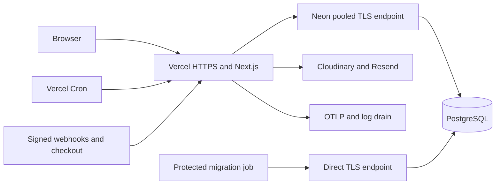

# Deployment

Separate Vercel projects and Neon databases isolate staging and production. Use a commercial hosting plan with minute scheduling and compatible runtime limits. Place functions near the database. Use a pooled, TLS-protected app role and a separate direct migration role. Keep provider keys and persistent storage separate.

1. Create independent staging and production application, database, email, and storage instances. Configure canonical origins and Google OAuth callbacks.
2. Configure protected GitHub deployment environments and required production reviewers. Disable competing production auto-deployments if the release workflow is the source of promotion.
3. Set a bounded PostgreSQL pool per process. Restrict app credentials to required data operations. Set UTC and a short statement timeout on the runtime role.
4. Apply additive migrations, then deploy to staging and exercise readiness, authentication, booking, test capture, refund, and scheduled work.
5. Enable explicit production approval after the launch checklist. Roll back application traffic to the previous compatible Vercel artifact if smoke checks fail. Preserve database changes and reconcile affected payments.

The alternative Dockerfile builds Next.js standalone output and runs as a non-root user. Apply database migrations separately using the release runner. Compose runs loopback PostgreSQL. Begin CSP rollout in report-only mode and test provider resources in staging before enforcing. [Vercel deployment CLI](https://vercel.com/docs/cli/deploy) · [Cron configuration](https://vercel.com/docs/project-configuration/vercel-json)
