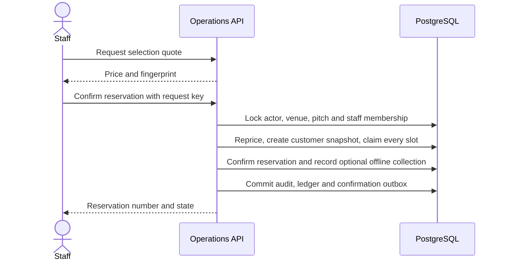

# Manual reservations

Select consecutive generated slots at a published pitch. Staff can select an existing verified customer by exact email or enter a guest name and phone with an optional email. A guest belongs to one venue and has no authentication account. The server validates selection, duration, pricing, add-ons, and player count.

Supported collection methods include cash, offline UPI, offline card, and bank transfer. Staff report those payments. A manual Razorpay selection creates a timed hold and emails the existing registered customer a checkout link. The existing signed capture flow confirms it. A manual reservation can confirm with an outstanding balance. A permitted operator can record one full settlement later. An unpaid reservation has no capture or receipt. The current flow handles full offline settlements and tracks refunds separately.

Send `Idempotency-Key` on the manual booking request. Reusing it with the same authenticated actor and payload returns the existing reservation. A different payload with the same key returns a conflict.
