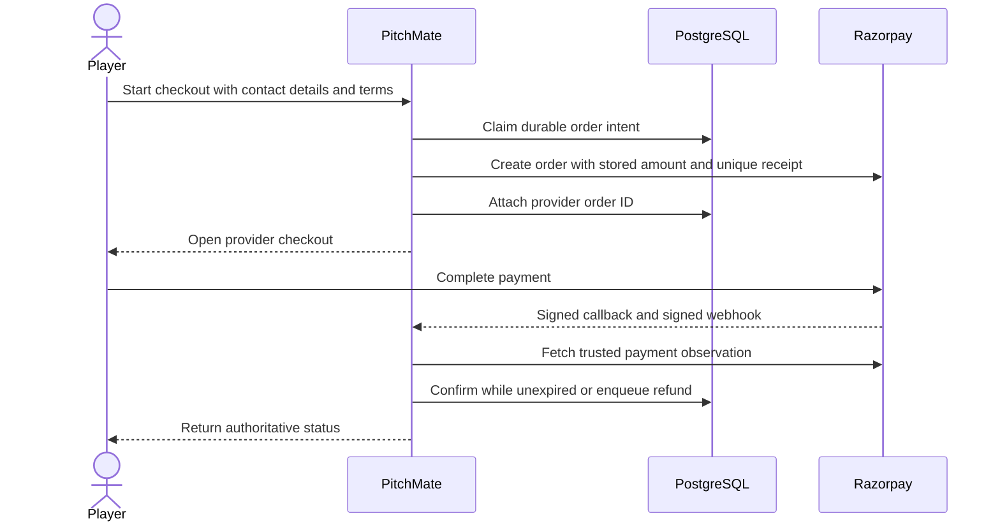

# Razorpay integration

Set `RAZORPAY_KEY_ID`, `RAZORPAY_KEY_SECRET`, and `RAZORPAY_WEBHOOK_SECRET` together in the server environment. Start with Razorpay test credentials and enable capture in the account's payment settings. Enter the webhook secret separately from the key secret. The browser receives the public key ID and a server-created order. The hosted Checkout SDK collects payment details.

A pending booking has one stable order intent and the provider can report multiple payment attempts for it. Order creation occurs after the claim commits. If the response is ambiguous, reconciliation looks up the original receipt before attaching the provider ID. It never blindly creates a replacement order. A failed charge can retry against the existing order while the hold remains valid.

Callback signatures use the stored order ID and the supplied payment ID. The service obtains the payment from Razorpay and checks the order, capture state, currency and amount. It accepts one charge only. A late, additional, or mismatched capture creates a compensation request. The refund worker uses Razorpay's documented refund idempotency header and an unchanged body keyed by the local refund UUID.

- [Razorpay Checkout setup](https://razorpay.com/docs/payments/payment-gateway/web-integration/standard/integration-steps)
- [Razorpay order lookup](https://razorpay.com/docs/api/orders/fetch-all)
- [Razorpay idempotent refunds](https://hdfcbank-collectnow-docs.razorpay.com/api/refunds/normal-refunds-idempotent/)
