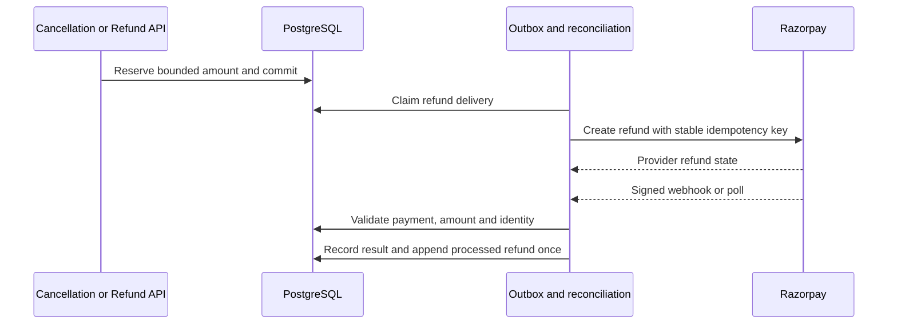

# Refund engine

Refund creation uses the original payment and a stable source key. The service and PostgreSQL check the sum of existing commitments against captured funds. Failed records remain reserved for investigation or reconciliation so an ambiguous provider response cannot authorize additional refunds.

Full and partial refunds share the same service as late and duplicate capture compensation. Offline refunds stay in the manual settlement queue. An authorized operator records a settlement reference after paying the customer. Recorded offline refunds never enter the Razorpay submission path. Admin retries preserve the refund identity and reconcile attempts with an existing provider reference.

See the [payment webhook runbook](PAYMENT_WEBHOOKS.md) for provider setup and the [ledger definitions](FINANCIAL_LEDGER.md) for statement interpretation.
