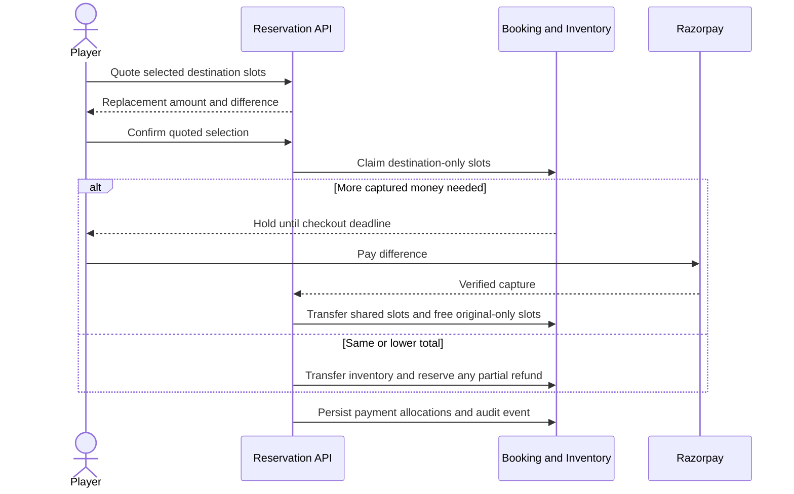

# Rescheduling

A confirmed future reservation may move to a different consecutive selection on the same pitch. This keeps one venue and pitch lock over both bookings, including overlapping time slots. The original pricing, booking history and revenue remain available.

A paid lower-price move reserves the difference against the original capture. An unpaid move creates a replacement with its own unpaid balance. A paid higher-price move uses a new Razorpay order for the difference and keeps the original booking confirmed until the payment is verified. Expired and failed replacement holds leave the original slots in place. A late replacement capture is compensated through the normal refund path.

Payment allocations describe which paid amounts fund the new reservation. A transfer never emits a capture event. Cross-pitch moves, repeated completed moves in one chain, and additional online charges for unregistered guests require a separate operational booking.
