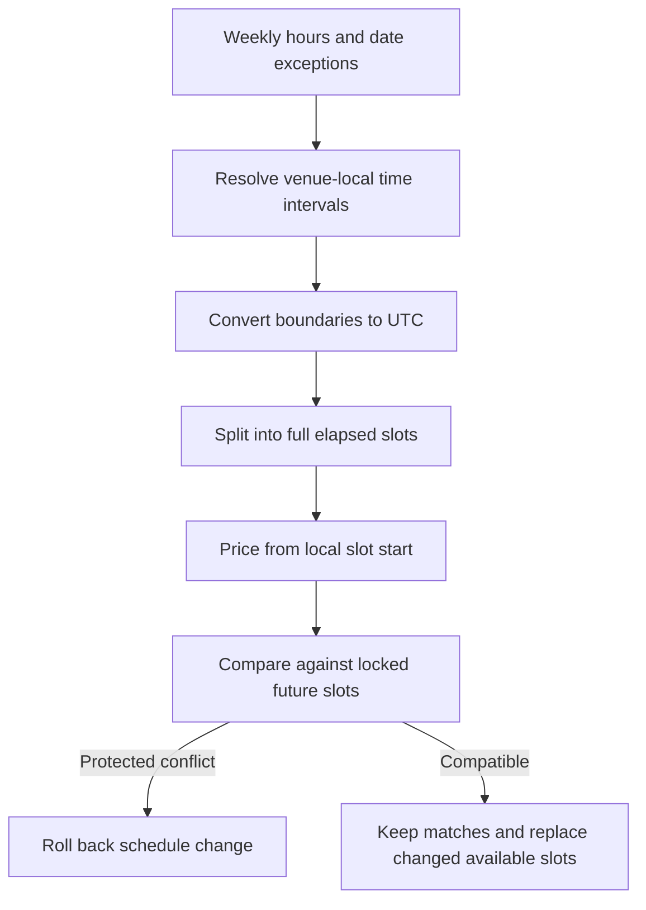

# Slot generation

Each pitch has a venue timezone, recurring local-minute intervals, date overrides, and a 30- or 60-minute slot grid. PostgreSQL stores resulting endpoints in UTC. The default rolling window covers today and the following 29 venue-local dates. `SLOT_GENERATION_DAYS` permits 1 to 90 days.

1. Start one civil date before the window to capture overnight hours. A date exception replaces that date's ordinary hours and incoming spill. An overnight exception may continue to the next date before its first ordinary opening, unless that date also has an override.
2. Convert interval boundaries using the venue's IANA timezone. Walk dates in civil order and step through each converted interval in elapsed minutes. Drop partial intervals and slots that start before the current instant.
3. Calculate the hourly rate from the local slot start and snapshot both the rate and slot price.
4. In a transaction, lock the venue and then the pitch. Retain identical available slots, history, maintenance blocks and protected slots. Delete only obsolete future available slots and insert only missing intervals. Reject schedule mutations that conflict with future held or booked slots.
5. Mark selected future slots as maintenance without changing timestamps. Unblocking reconciles the slots with current rules. The database excludes overlapping half-open intervals even if a caller bypasses the service.

Run `bun run slots:extend` from a scheduler or send a POST to `/api/jobs/availability` with `Authorization: Bearer <SLOT_JOB_SECRET>`. The HTTP job returns `nextCursor`. Continue with that cursor until it is null. Re-running a batch does not create duplicates. It also retries aged media cleanups at the start of a run.
