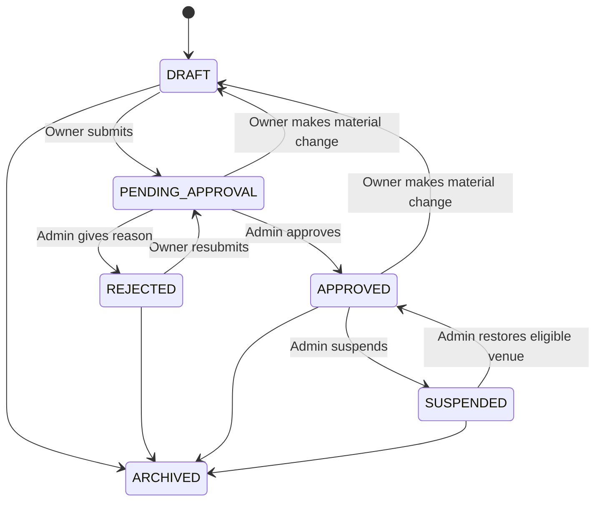

# Venue management

An operator verifies an active owner who has confirmed their email with `bun run db:verify-owner owner@example.com`. The command reads the configured database and writes an audit record. Verified owners use My Turfs to draft, edit, and archive their own venues.

A submission requires complete public contact and address information, coordinates, a cover image, and an active pitch with an operating schedule. All active pitches must have operating hours. Approval and publication are separate. An approved owner publishes from the review step. Restoration returns the venue to approved and requires a fresh publish action. A rejected venue retains review feedback until resubmission.

Material edits include venue details, amenities, gallery changes, adding a pitch, or editing a pitch's public details or active state. Material edits return an approved or pending venue to draft and clear publication. Pricing, slot lengths, weekly schedules, exceptions, and maintenance changes reconcile future inventory without changing the venue's review status. Archiving preserves history and rejects venues with current held or booked inventory.

The seven setup steps are basic information, location, facilities, photos, pitches, operating schedule, and review. Photos can be uploaded in a batch from the browser through one-file server requests, reordered, edited, removed, and chosen as cover. Dates and times for existing slots are shown in the venue timezone.
